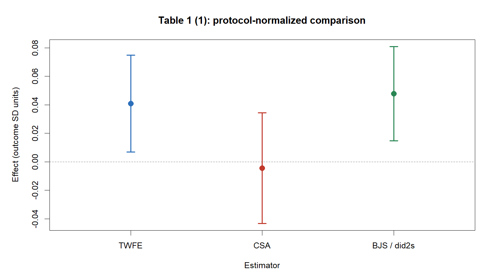
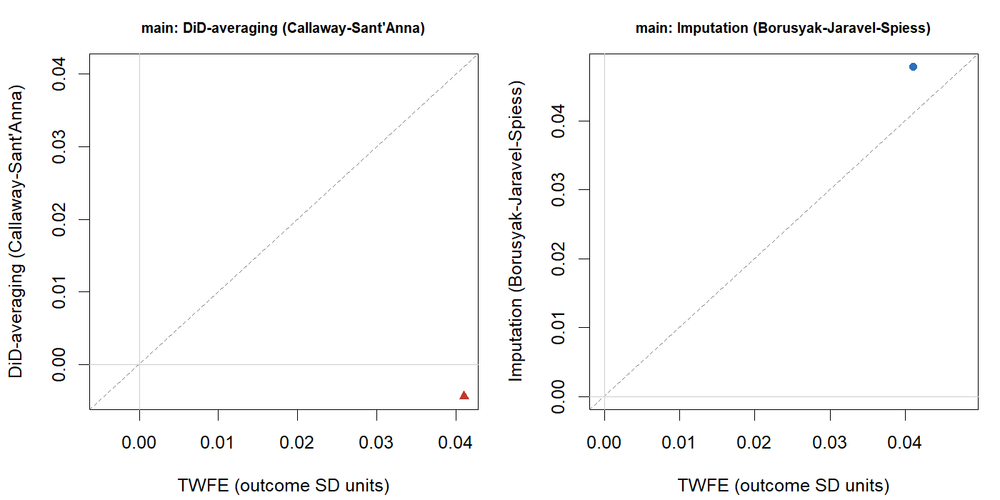
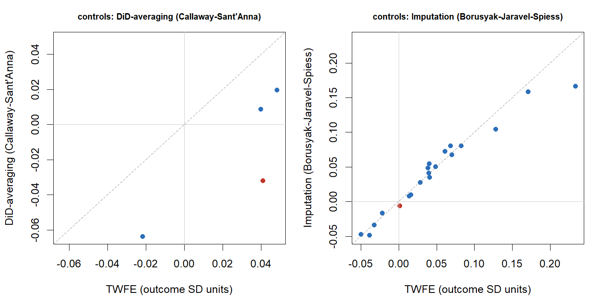

# 按 Replication_cn 协议完成的单篇重估

对象：唐跃桓、黎静霖（2026）《新型产业政策何以提升企业生产率——来自产业链链长制的证据》，《中国工业经济》第9期，73—95页。

**这次执行的是老师项目的统一重估阶段，和此前运行作者程序的结果核对分开。已筛选全部28个正文表列，生成并运行1个主样本、20个带控制变量的二级样本设定，每个静态设定均运行999次联合自助法。7个交互项设定按协议排除，在线附录不混入正文主样本。**

## 主要发现

主样本只有原文表1第(1)列，即作者确实发表过的无控制变量TWFE。没有从作者偏好列中删除控制变量来另造“无控制”模型。三个估计量的输入样本相同，使用真实首次处理年份、城市聚类，因变量除以该输入样本内的总体标准差，未重复对TFP取对数。

| 方法 | 标准化系数 | 标准误 | 95%区间 |
|---|---:|---:|---|
| TWFE | 0.041012 | 0.017349 | [0.007008, 0.075016] |
| CSA | -0.004413 | 0.019849 | [-0.043316, 0.034490] |
| BJS / did2s | 0.047831 | 0.016892 | [0.014723, 0.080940] |

CSA点估计由正转负，但其自身95%区间覆盖0，**不能解释成“政策显著降低生产率”**。按项目的“反号且估计量差异显著”定义，CSA与TWFE的差异为-0.045426，联合999次自助法协方差下，差异检验z=-2.096、p=0.0361；因此这个单独设定记为sig_flip。BJS仍为正，与TWFE之差为0.006819，差异p=0.0382。

该主样本列不是作者偏好列。仅凭这一列，不能宣称整篇论文结论被推翻，也不能将单篇的反号比例推广为全刊文献比例。

## 作者设定与协议规范化的区别

第一阶段，作者偏好的表1第(4)列已用Stata复现为0.040032。此次又用R保留作者原始时变行业设定交叉核算，得到0.040032003，证明该原模型在两种软件中的点估计一致。

但协议要求与时间交互的特征对个体固定不变。原始数据中377家企业的行业代码曾变化；因此各设定在其输入样本内按首期固定行业。偏好列固定行业后，协议TWFE原单位系数为0.029711，标准化后为0.028023，BJS为0.027652。**这部分原TWFE的变化来自协议要求的设定规范化，不能归因于换用BJS。** 该列的行业类别超过60，CSA按协议不报告。

样本先锁定作者每列e(sample)，所以原始发表结果的复现和规范化重估可明确区分。三方法共用同一输入数据与处理定义，但不同估计量的有效支持不完全一样：主样本输入N=25082、TWFE有效N=25082；BJS有653个观测的反事实固定效应无法插补，按仓库规则剔除，剩余24429个输入观测、2439个处理观测。CSA使用未处理及尚未处理对照，并按项目的simple聚合权重计算，另保留csa_hullw。

冻结行业还会改变部分固定效应单例观测的处理。各列的作者样本N、协议输入N、TWFE有效N与BJS可插补N全部见 `project/output/design_audit.csv`，不把“统一输入样本”误称为“有效权重和支持范围完全相同”。

## 杠杆筛选与负权重

阈值按协议：G_eff至少10、最大聚类份额不超过0.25。主样本TWFE、CSA、BJS的有效聚类数分别为25.12、12.90、15.80；最大聚类份额分别为0.1416、0.1712、0.1624，三者均通过。

主样本处理观测中负权重的行数比例为12.10%，负权重占绝对权重的比例为0.81%。这是权重诊断，不单凭该比例认定反号原因。

## 二级样本及实现限制

- 20个带时变控制变量设定已全部运行；BJS/did2s均给出点估计和标准误。
- 全部21个设定中，CSA得到数值的有5个；11个因特征类别超60按协议跳过；5个在指定控制和特征模型下由did报估计/聚合失败。全部保留具体csa_note和完整日志，未删除控制变量、改比较组或填造结果来“跑通”。
- 仓库v0.1未实现带控制变量现代估计量的杠杆影响系数时，相应G_eff/L_max为NA；其汇总明确标为twfe_only，仅按TWFE筛选，不能解释成现代估计量也通过了双边筛选。
- 每个静态设定均计算999次TWFE/BJS联合自助法；主样本还计算TWFE/CSA联合协方差。带控制变量CSA的联合协方差不受该版本实现支持，沿用项目明确允许的第一版0协方差约定，并逐项标注 `zero_placeholder_v0.1`。这不是声称已经计算了该协方差。
- 一篇论文不能产生有意义的跨论文相关性或逐篇剔除区间。这些记为不适用；相关汇总只描述本次单篇试运行。

## 与仓库的对应及验证

1. 依据[老师项目](https://github.com/wenddymacro/Replication_cn)本地冻结快照的PROTOCOL、SCREENING、REPLICATION和SPEC_SCHEMA执行，输入/输出结构保持兼容。
2. `project/data/screening/by_paper/cie20260904.json`：逐列筛选；`project/data/specs/`：1个主样本；`project/data/specs_controls/`：20个二级设定。
3. `project/code/R/run_spec.R`、`analysis.R`及测试脚本保留仓库原文件；`estimators.R`只补齐CSA类别超限分支缺失的NA输出字段。原文件保存于`upstream/estimators_original.R`，源文件哈希与使用版本见`logs/source_lock.csv`。
4. 另用`analysis_protocol.R`修复差异检验的方差一致性：有联合自助结果时，使用同一矩阵的两项边际方差与协方差，即Var(现代−TWFE)=Var(现代)+Var(TWFE)−2Cov。原脚本混用解析边际SE和自助协方差，可能产生负方差，再把相关系数压至0.999而得到不可靠的极小p值。本报告不使用该处理，原始汇总保存在`project/output/upstream_summary/`；点估计未变，999次结果未重抽。未计算联合协方差的二级CSA仍明确按0协方差约定计算。
5. 仓库估计量正确性测试全部通过，含平衡/不平衡面板CSA核对、BJS影响系数核对、固定效应与事件研究模拟检查。
6. 输出字段修复经单独验证：T1(4)修复前后TWFE/BJS点估计、SE、原单位TWFE和y_sd一致。交付脚本另行干净跑通21个设定，168项点估计/SE等核对均与正式结果一致；既有999次计算未被重写为0次。全部21个输出的boot_B均为999。
7. R 4.6.2，fixest 0.14.2，did 2.5.1，did2s 1.2.1；完整环境版本见`logs/package_versions.csv`。Windows使用ASCII计算暂存目录以避免路径兼容问题，交付结果和数据仍在指定项目文件夹。
8. 裁定追加于`project/docs/PROTOCOL.md`第7节，不删改上游旧裁定。`project/output/tables/funnel.md`仅覆盖本次1篇试运行，不能理解为《中国工业经济》全刊数量。

## 文件入口

- [全部设定结果](全部设定结果.md)：逐列查看原文、规范化TWFE、CSA、BJS和不可估原因。
- `project/output/all_spec_results.csv`：21个设定的完整输出。
- `project/output/all_comparisons.csv`：差异检验、协方差约定、反号、SE比和筛选依据。
- `project/output/tables/comparison_summary.md`：仓库脚本生成的分主/二级、筛选前/后汇总。
- `project/output/design_audit.csv`：输入与有效样本审计。
- `logs/`：每个设定及999次计算的日志、测试、版本记录。
- `data/analysis.csv`：通过CIE_RAW传入的工作副本，包含作者数据与逐列样本标记；作者原件未修改。

重新运行见`run_protocol.ps1`。本次999次联合自助法用于估计量之间差异，与第一阶段作者九组1000次费舍尔式随机检验是两类不同检验。
